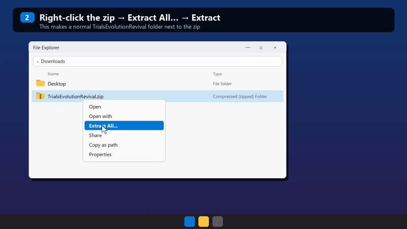

# EVO Redux — Trials Evolution: Gold Edition, back online

Ubisoft shut down the online servers for **Trials Evolution: Gold Edition** (PC) years ago, and
with them went the leaderboards, the ghosts, Track Central and multiplayer. **EVO Redux** is a
fan-made replacement server that brings them back.

**The goal is for everything to work again** — leaderboards, ghosts, Track Central, multiplayer
and the rest of the online side, as it did on day one. We're not there yet, but the leaderboards
are live right now and waiting for times.

Not affiliated with Ubisoft or RedLynx. You need your own copy of the game (Steam or Ubisoft Connect).

---

## Thank you — and please spread the word

To everyone who has already installed this and put a time on the board: **thank you.** A
leaderboard is only as good as the people on it, and every run you upload brings these boards
a little closer to what they used to be.

If you enjoy it, **tell people.** Post it in your Discords, share it with your old Trials
friends, drop it in the Steam forums. The more riders come back, the more these great
leaderboards fill up again — let's bring the glory back to them.

---

## What works today

- ✅ **Online login** through the revival server
- ✅ **Global and per-track leaderboards** for every track in the game
- ✅ **Ghosts** — upload your best run, download and race other players' ghosts
- ✅ **Track Central tracks you have installed** are playable, with leaderboards that include
  thousands of archived historical scores (see [Get Track Central tracks](#get-track-central-tracks)
  and [Legacy spots](#legacy-spots-the-historical-scores))
- ✅ Occasional revival messages in the main-menu news ticker
- ✅ **Xbox 360 DLC packs run on PC** — Origin of Pain and Riders of Doom, including Neverending
  Trials, fire effects and their leaderboards (see [Xbox 360 DLC](#xbox-360-dlc))

## The plan

The aim is the full online experience, not just part of it:

- 🔜 **Multiplayer** — online races with other players
- 🔜 **Track Central in full** — browsing, downloading, rating and uploading tracks (over 690
  community tracks have already been preserved)
- 🔜 Everything else the original servers did, one piece at a time

Progress is posted here as features come online.

---

## Legacy spots (the historical scores)

When the official servers were still up, the game kept a local copy of each Track Central
track's global leaderboard. We recovered those cached boards from a large archive of
preserved tracks and loaded them back in: **58,543 historical scores from 6,559 players.**

On Track Central boards these show up as players named **`Legacy#<number>`**:

- They are **real scores from the original servers**, recorded before the shutdown (the archive
  dates from December 2017).
- The game only stored each player's ID number, not their name, so the original riders appear
  by number.
- They are ranked **right alongside new runs.** Beat a legacy time and you take its place — some
  of these are seriously fast.
- Legacy entries can't be claimed or logged into; they're there as the benchmark to chase.

---

## Install (players)

**30-second video walkthrough** (click to watch):

1. **Close the game.**
2. Download the player package: `TrialsEvolutionRevival.zip` from the
   [Releases](../../releases) page — or click **Code → Download ZIP** here and open the
   `player_package` folder.
3. **Unzip it first** (right-click → *Extract All* → *Extract*), open the extracted
   `TrialsEvolutionRevival` folder and double-click **`INSTALL.bat`**. It finds the game by itself,
   whether you have it on Steam or Ubisoft Connect. (If it can't write to the game folder,
   right-click it → *Run as administrator*.)
4. Start Trials Evolution as usual. Ubisoft Connect still opens; that's expected.

If Steam or Ubisoft Connect ever **verifies game files**, the fix is removed — just run
`INSTALL.bat` again. To remove everything, run **`UNINSTALL.bat`**.

### Still offline?

- Make sure you have the **latest release** (v1.2 or newer). Older versions only worked on the
  Steam copy of the game, so Ubisoft Connect players stayed offline.
- Run `INSTALL.bat` again after downloading it, then start the game.
- Still offline? Send us `trials_revive_shim.log` from the game's `datapack` folder (on Steam:
  `...\steamapps\common\TrialsPC\datapack\`). It says exactly what went wrong.

### Your revival login

The first time you play, the game creates `trials_revive_login.key` in the game's `datapack`
folder (on Steam: `...\steamapps\common\TrialsPC\datapack\`). **Back it up.** The first key used with your Ubisoft
name claims that name on the boards; if you reinstall, copy the file back. If you lose it, ask
the server admin to release your name (your scores and ghosts stay attached to it).

---

## Get Track Central tracks

Browsing and downloading tracks inside the game isn't back yet. Until it is, the community has
an archive of **about 700 of the best-rated Track Central tracks**, shared by Scruffy McGuffy on
the Steam forums:

**[Archive of Track Central tracks (Steam discussion)](https://steamcommunity.com/app/220160/discussions/0/1680315447969304289/)**

1. Download the archive from the link in that thread.
2. Extract it into `Documents\Ubisoft\Trials Evolution Gold Edition\SavedGames`.
3. Start the game: the tracks show up under Track Central.

With EVO Redux installed they're **playable with working leaderboards**, including the original
scores from before the shutdown ([Legacy spots](#legacy-spots-the-historical-scores)). Set a
time and you're on the board with them.

---

## Xbox 360 DLC

The PC Gold Edition never got the Xbox 360 DLC packs. EVO Redux makes them run on PC:
**Origin of Pain** and **Riders of Doom**, including Neverending Trials with its endless
generated rounds, the fire effects, and online leaderboards for every DLC track.

EVO Redux does **not** include the DLC itself. The tracks and assets belong to Ubisoft/RedLynx
and are not distributed here. You need your own copy of the DLC packs, dumped from your own
Xbox 360, converted for the PC game and placed in `datapack\DLCContent\OriginofPain` and
`datapack\DLCContent\RidersofDoom`.

A guided importer that does the conversion for you is in progress. Until then, the conversion
tools are in [`tools/`](tools) (`stfs_extract.py`, `dlc_convert.py` and the other `dlc_*.py`
scripts) for anyone comfortable running Python. The installer already switches on the DLC
fixes, so once the packs are in place there is nothing else to set up.

---

## Your Ubisoft password stays on your PC

The game sends whatever password Ubisoft Connect hands it to the online server, and its built-in
network encryption uses a key that is publicly known — so that password would be readable by
anyone on the network path. That's why the installer exists:

- The installed file (`ubiorbitapi_r2_loader.dll`) sits in front of Ubisoft's loader and
  **replaces your password and CD key with a random revival key** before the game ever sees
  them. Your real password never leaves your PC.
- **The server only talks to games that have this file.** A game without it (for example after
  a Steam file verification) is simply offline, like before the revival, and never sends
  anything to the server.
- Ubisoft Connect, your saves and your ownership check are untouched. Everything else is
  forwarded to Ubisoft's original DLL unchanged.

All of this is open source in [`client_shim/`](client_shim) — read it, build it yourself if you
like (`client_shim/build.bat`, Visual Studio 2022 C++ workload).

---

## For developers

| Path | What it is |
|---|---|
| `server.py`, `prudp.py`, `quazal.py` | The server: Quazal PRUDP transport + the RendezVous services the game uses (auth, secure, leaderboards, ghosts/user storage, Track Central/UGC) and the HTTP online-config endpoint |
| `boards.json` | Leaderboard sort orders, generated from the game's own track list by `tools/gen_boards.py` |
| `client_shim/` | Source of the player DLL (login protection, server gate, menu ticker) |
| `player_package/` | What players install |
| `tools/` | Admin and research tools: name release, historical board import, board generation, and pak/XMem utilities |

Run a local server with `start_server.bat` (Python 3; set `TRIALS_HOST` to the address players
connect to). The server creates its own `server_secret.key` and `trials.db` on first start —
never share or commit those.

---

## Support

The server costs real money to run. If you'd like to help keep it online:
**[ko-fi.com/StewYork91](https://ko-fi.com/StewYork91)** — thank you!

*Trials Evolution is a trademark of Ubisoft Entertainment. This project contains no Ubisoft or
RedLynx game files.*
